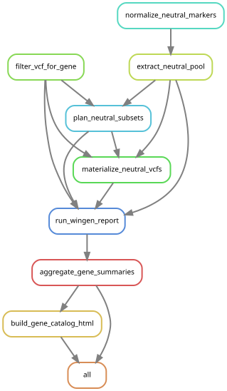

# Wingen-Project

A reproducible Snakemake pipeline for mapping geographical genetic diversity variation across a catalog of genes using the moving-window and kriging approach of the R-package wingen. The pipeline was developed for marine species but has also been adapted to work for the study of terrestial species.
The input files are a cohort VCF, a table of geographical sample coordinates, and a gene list (*Note: If the user has a snpEff processed VCF-file, the gene list can automatically be generated, as well as gene scope-specific filtering can be made to filter the scope of the genes by setting the 'gene_scope' parameter in 'config.yaml' to "all" (default)|"body"|"exonic"|"cds")*. The output is a browsable HTML catalog ('gene_catalog.html') with a gallery of genetic diversity maps per gene. For marine species, the HTML catalog compares genetic diversity with environmental data accessed through the R-package CopernicusMarine (salinity, water temperature, log(chlorophyll-a), dissolved oxygen and current speed). **Equivalent statistics might be added to terrestial species in the future.**


Dependency graph for the Snakemake workflow with neutral simulations and `gene_scope: all` enabled. The
diagram follows the Snakefile's rule input.

For each gene in the gene list:

1. **`filter_vcf_for_gene`**: Subsets the cohort VCF down to only containing the variants of the gene.
2. **`narrow_vcf_by_scope`** (optionally for snpEff-annotated VCF-files): Narrow further to a body/exonic/cds annotation scope.
3. **`plan_neutral_subsets` / `materialize_neutral_vcfs`** (when `run_neutral_sim: true`): Draws a subset of the neutral markers from the neutral marker pool with the same marker-count as the studied gene and then saves them as VCFs to be used during that gene's wingen run. `normalize_neutral_markers` converts an table of annotated markers to a neutral markers only chromosome/position TSV (If the user provide a file containing only the position of the neutral markers, skip that step). With `vcf_annotation_format: snpeff` and neither `markers_file` nor `neutral_vcf` defined, `extract_neutral_markers_snpeff` instead calls `snpeff_vcf_create_neutral_marker_file.sh` to obtain intergenic SNP coordinates from the SnpEff processed VCF-file.
`extract_neutral_pool` selects those coordinates from the cohort VCF and writes `target_markers.tsv`, the neutral VCF and its CSI index. Alternatively, `neutral_vcf` supplies an already-neutral VCF, so `markers_file`, table conversion and pool extraction are unnecessary.
4. **`run_wingen_report`**: Runs `code/2_Herring_Wingen.Rmd` and creates a moving-window diversity layer over the geographical sample points, then kriged into a smooth map, optionally masked by sample count support, distance from empirical samples and lastly a supplied species-range polygon (i.e a distribution or spawning-area layer). The outputs are heatmap plots as well as a per-gene .json file containing summary statistics, including correlations between genetic diversity and latitude or environmental metrics such as salinity, water temperature, log(chlorophyll-a), dissolved oxygen and current speed. When enabled, the neutral comparison reuses the prepared VCFs for location statistics.
5. **`aggregate_gene_summaries`**: Once every gene is done, combine every summary into one DuckDB database and TSV.
6. **`build_gene_catalog_html`**: Creates a single sortable, searchable HTML gene catalog (via Jinja2) from that database.

## Two ways to run this

- **`workflow/batch_job_gene_catalog_snakemake.sh (Snakefile)`**: The key pipeline. Produces the browsable HTML catalog.
- **`code/2_wingen_create_gene_catalog.sh`**: An older script kept for reference. Useful for tuning wingen's own parameter settings on a single gene before committing to a full gene catalog run. As an example useful check for taking into account how geographically sparse the dataset is and how sample density affects the rolling window computation and interpolation. 

## Repository structure

```
Wingen-Project/
├── wingen-gene-catalog.def        # Apptainer build recipe
├── pixi.toml / pixi.lock          # Snakemake + Apptainer
├── images/
│   └── rulegraph.svg              # snakemake --rulegraph | dot -Tsvg
├── config/
│   ├── config.yaml                # all settings — see README - Config.md
│   └── env_presets.yaml           # which Copernicus Marine datasets ENV_PRESET can pick (global, baltic, ...)
├── workflow/
│   ├── Snakefile
│   └── batch_job_gene_catalog_snakemake.sh
├── code/
│   ├── 2_Herring_Wingen.Rmd # Main script, creates the genetic diversity heatmaps and compute environmentally-based statistics
│   ├── 2_wingen_create_gene_catalog.sh
│   ├── install_wingen_env.sh      # Optional local-conda alternative
│   ├── filter_vcf_by_chr_or_gene.sh
│   ├── filter_vcf_by_scope.sh
│   ├── snpeff_vcf_detect_unique_genes.sh
│   ├── snpeff_vcf_create_neutral_marker_file.sh # intergenic SNPs -> CHROM/POS TSV
│   ├── build_gene_chrom_map.py
│   ├── aggregate_gene_summaries.py
│   ├── 1_neutral_simulation_markers.py # optional annotated/curated table conversion
│   ├── 2_neutral_simulation_vcfs.sh   # bcftools pool extraction and saved subset VCFs
│   ├── 3_neutral_simulation_subsets.py # seeded sampling, record checks and provenance
│   ├── build_gene_catalog_html.py
│   └── templates/gene_catalog_template.html
├── data/raw/<dataset>/
└── results/
    └── gene_catalog_<name>/          # results_dir in config.yaml — one folder per catalog
        ├── .snakemake_gene_catalog/  # Snakemake's own per-gene .done markers
        ├── benchmarks/               # Per-gene runtime/memory (--benchmark)
        ├── temp/                     # env_cache/, ne_cache/ and neutral preparation
        │   ├── filtered_vcf/
        │   │   └── {chrom}/
        │   │       ├── {gene}_filtered.vcf.gz
        │   │       └── {gene}_{gene_scope}.vcf.gz # when scope narrowing is enabled
        │   └── neutral_model/
        │       └── {chrom}/{gene}/
        │           ├── subsets.tsv / plan_metadata.json
        │           └── prepared_vcfs/ # saved VCFs, CSI indexes and manifest.json
        └── results/                  # The final output of the gene catalog
            ├── {chrom}/{gene}_gene_summary.json
            ├── {chrom}/{gene}_per_location.tsv   # one row per location: the numbers behind the location-level fits
            ├── gene_catalog.duckdb
            ├── gene_catalog_summary.tsv
            └── gene_catalog.html     # The final deliverable
```

Each gene's outputs are grouped under the chromosome of the studied gene.
Its neutral subsets use that same chromosome and gene grouping, even when the
selected neutral SNPs come from chromosomes across the genome.

## Setup

Two independent things to install: Snakemake & Apptainer via pixi and the apptainer container to execute the pipeline from.

**1. Snakemake + Apptainer, via pixi:**
For pipeline orchestration and containerization a pixi enviroment including Snakemake v9.27.0 & Apptainer v1.4.5 can be fetched through a lock file. The pixi environment gets installed by running the following commands from the root folder of the repository:
```bash
curl -fsSL https://pixi.sh/install.sh | bash
pixi install
```
**2. Installing the Apptainer container as a .sif file from .def-file.**
```bash
apptainer build wingen-gene-catalog.sif wingen-gene-catalog.def
```
This needs to match `CONTAINER` in `workflow/Snakefile` and `batch_job_gene_catalog_snakemake.sh` to actually get used. The batch script will then activate it with `--sdm apptainer` and the snakemake workflow will then run entirely inside of it.

If you prefer to run a local environment, a runnable conda environment can be created by running `install_wingen_env.sh` (requires conda-lock installed). This environment is however not wired into the workflow by default and would require changes to both 'Snakefile' and 'batch_job_gene_catalog_snakemake.sh'.

## Configuring a run

Everything pipeline-specific lives in `config/config.yaml` (see **`README - Config.md`** for what every setting does). Before a full run on a new dataset, tune the window/resolution settings against your sample density first, using the implemented `preview_gd()` step in `code/2_Herring_Wingen.Rmd`.

## Running

```bash
sbatch workflow/batch_job_gene_catalog_snakemake.sh
```

```bash
snakemake -n              # dry run
snakemake --cores 4        # run locally
snakemake --unlock         # after an interrupted run
```

Tip: To run a subset of the gene catalog set `gene_list_limit` in `config.yaml`.

## Input data requirements
*  **Sample coordinates**: a `.xlsx`/`.csv` file with one row per individual. First column is the sample ID; latitude and longitude must then be in separte columns with no column index restrictions, since they are matched by column name; latitude|latitud and longitude|longitud|longtitude respectively.
* **Note:** wingen requires the genetic data *to be in the same sample order* as the geographical coordinate data (VCF-file: column-wise ; Dataframe: Row-wise) and this holds true for both `window_gd()` and `window_general()`. However this pipeline has no such requirements for the VCF workflow since there is a built in preprocessing step which matches the individuals **by ID** and sorts the coordinate file accordingly.

### Genetic Diversity Metric from VCF-file
* **VCF**: The rolling window computation will be performed using `window_gd()`. To set the genetic diversity metric to map, assign the `gd_stat` parameter in `config.yaml`. Wingens default options `"pi"`, `"Ho"`, `"biallelic_richness"` and additional support has been added for `theta` (hierfstat::theta.Watt.dosage) & `tajimas_d` (hierfstat::TajimaD.dosage) using hierfstat v0.5-11. The chosen metric then carries through to plot titles, column headers and filenames automatically. If the VCF-file is SnpEff-annotated (`INFO/ANN`), gene-scope specific filtering is available by setting the `gene_scope` parameter in `config.yaml`.
### General Diversity Metric
* **Dataframe**: an input dataframe of an arbitrary genetic diversity statistic, with the data's order matching the order of the coordinate file. The rolling window computation will be performed using wingen's `window_general()` function and allows for creating genetic diversity maps of allelic frequency, F<sub>ROH</sub>, etc.
* *Note*: the pipeline has been built for a VCF-file-based workflow, **but support for general diversity metrics by supplying a dataframe might be added in the future**.

## Neutral marker comparison

The optional neutral comparison asks whether a gene's diversity–environment association is stronger than associations from equally sized random sets of neutral SNPs. The pipeline extracts the pool of neutral markers from the input VCF-file using bcftools and creates, from the pool neutral markers, marker-count-matched neutral subsets per gene, and compares absolute Pearson and Spearman correlations using the same location cluster-based estimation. To add these monte carlo simulations of the neutral model to the workflow, simply set `run_neutral_sim: true` in `config.yaml` and provide a file with annotation of the neutral markers in the VCF-dataset (`markers_file` or `neutral_vcf`), or use automatic intergenic extraction from a SnpEff processed VCF-file.
